# TermFlow 사용자 가이드

| 항목 | 값 |
|---|---|
| 문서 | `docs/사용자_가이드.md` v1.3 (2026-10-11, TermFlow v1.3.0 이후 — §9 외부 연동) |
| 대상 | TermFlow 화면을 쓰는 모든 사용자(역할별 요약) |
| 보는 곳 | 제품 화면 **[설명서]**(상단 바 오른쪽 `?` 단추 · 로그인 화면의 [사용자 가이드], 주소 `/manual`) — 로그인하지 않아도 열린다 |
| 설치·운영 | [설치·운영 가이드](설치_운영_가이드.md) (시스템 관리자용) |
| 화면 그림 | 가상 데모 프로젝트 `EDU`(교육 운영 관리)로 찍었다 — 실제 화면과 내용(프로젝트·테이블 이름)이 다를 수 있다 |

TermFlow는 **표준 용어로 컬럼을 자동완성해 테이블을 설계하고 DDL(PostgreSQL)까지 만드는** 사내 서비스다. 모든 데이터(표준 사전·테이블)는 **프로젝트** 안에 있고, 사용자는 프로젝트마다 역할을 받는다.

## 1. 역할과 할 수 있는 일

| 역할 | 범위 | 주요 작업 |
|---|---|---|
| **시스템 관리자** | 전체 | 사용자 계정, 프로젝트 생성·보관·삭제, 템플릿 관리·게시. 모든 프로젝트에서 프로젝트 관리자 권한 |
| **프로젝트 관리자** | 프로젝트 | 프로젝트 설정·멤버·업무구분, 표준 사전 편집·일괄 등록·승인·재계산, 확정(FINAL) 해제, 테이블 작업 전부 |
| **편집자** | 프로젝트 | 테이블 설계(생성·수정·삭제·복제·확정), 미등록 용어 인라인 등록(검토대기), DDL |
| **조회자** | 프로젝트 | 프로젝트 전체 조회(표준 사전 포함), DDL 미리보기·복사·다운로드·정보 추출 |

- 멤버가 아닌 프로젝트는 보이지 않는다(주소로 들어가도 "프로젝트를 찾을 수 없습니다").
- 역할이 부족한 버튼은 숨겨지거나 비활성이다. 확정(FINAL) 테이블은 읽기 전용이다.

## 2. 공통

### 2.1 로그인·비밀번호
1. 브라우저에서 시스템 관리자가 알려 준 주소(예 `http://<PC 이름>:7340`)로 접속 → 아이디·비밀번호.
2. 처음 로그인하거나 관리자가 비밀번호를 초기화한 경우 **비밀번호 변경 화면으로 바로 이동**한다. 규칙: 8~64자, 영문·숫자·특수문자 중 2종 이상, 아이디 포함 금지, 직전 비밀번호와 다르게.
3. 5회 연속 틀리면 15분 잠긴다(시스템 관리자가 해제 가능).
4. 비밀번호 변경은 오른쪽 위 사용자 메뉴 › [내 계정]. 60분 동안 아무 작업이 없으면 로그아웃된다 — 로그인 화면에 그 안내가 뜨고, 다시 로그인하면 보던 화면으로 돌아간다. 편집 중이던 테이블은 브라우저에 임시 저장되어 복원을 제안한다.

![로그인 화면 — 아래쪽 [사용자 가이드] 링크로 이 설명서를 연다](img/screens/01-login.png)

### 2.2 화면 구성
- **프로젝트 목록**(`/projects`): 내가 속한 프로젝트 카드(키·이름·내 역할·업무구분·테이블 수).
- **왼쪽 메뉴**: 위쪽 프로젝트 전환 → [설계] 홈·테이블·DDL 내보내기 / [표준 사전] 용어·도메인분류·도메인·코드·기본컬럼·승인 큐 / [프로젝트] 업무구분·설정 / [시스템](시스템 관리자) 사용자·프로젝트·템플릿.
- **상단 검색**: 현재 프로젝트의 용어·도메인·테이블 검색. 오른쪽 `?` 단추는 이 **설명서**.
- 목록 공통: 검색·필터·정렬·페이지(20/50/100), 행 인라인 편집(Enter 저장, Esc 취소). 삭제는 확인 창이 한 번 뜬다.

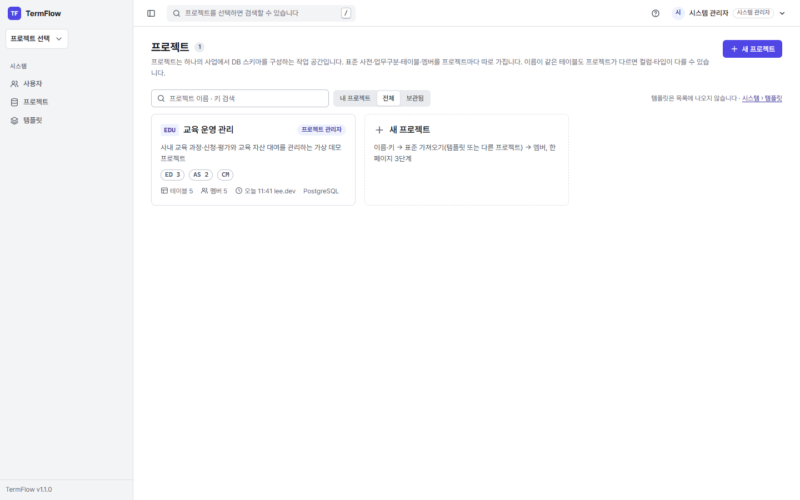

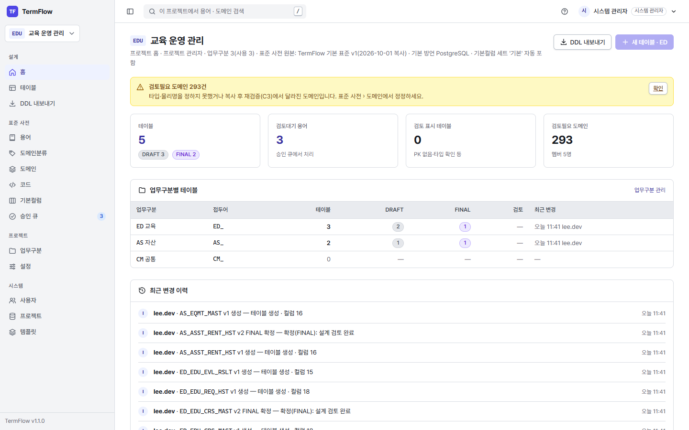

### 2.3 템플릿과 승계 데이터
- 템플릿 **TermFlow 기본 표준 v1**(`STDV1`, v1.2.0~): 어느 조직에서나 쓸 수 있게 정리한 범용 기본 표준. 업무구분 10(공통·시스템·인사·회계·예산·계약·전자결재·영업·판매·구매·재고·물류) · 용어 1,316 · 도메인분류 71 · 도메인 1,020 · 코드구분 104(국가·통화·시도·은행 등 표준 코드 포함) · 기본컬럼 2세트. 검토필요 0건. **새 프로젝트의 기본 원본.**
- 템플릿 **패션·유통 표준 v1**(`RETAILV1`): gen-table에서 승계한 표준 사전(업무구분 6·용어 1,705·도메인분류 84·도메인 4,587·코드 991·기본컬럼 9). 패션·유통 업종 프로젝트를 만들 때 원본으로 고른다. v1.1.x까지는 이 템플릿의 키가 `STDV1`이었다.
- 프로젝트 **연구관리시스템(이관)**(`RMS`): RETAILV1 복사본 + 이관 테이블 33개(업무구분 RP, 확정 상태).
- RETAILV1·RMS의 도메인 293건은 **검토필요**(타입을 정할 수 없던 승계 데이터)로 표시되어 있다 — 정정은 시스템 관리자가 한다([설치·운영 가이드 §4.4](설치_운영_가이드.md#44-정정정정-담당자-시스템-관리자)). 편집기에서는 경고로 보인다.
- 물리명은 용어사전 기준이다: 마스터 = `MAST`(예 `RP_RSCH_PRJ_MAST`), 등록자 = `RGSRT`(`FIRS_RGSRT_ID`·`FINA_RGSRT_ID`).

## 3. 시스템 관리자

### 3.1 사용자 관리 (`/admin/users`)
1. [시스템 › 사용자] → [계정 생성]: 아이디·이름·이메일(선택)·시스템 관리자 여부 → 저장 → **초기 비밀번호가 이 화면에서 한 번만 표시**된다(닫으면 다시 볼 수 없다). 사용자에게 전달하면 첫 로그인 때 바꾸게 된다.
2. 행 메뉴: 비밀번호 초기화(새 임시 비밀번호 1회 표시) · 잠금 해제 · 비활성화(로그인 불가, 기록 유지) · 시스템 관리자 지정/해제.
3. 시스템 관리자는 **2명 이상** 두는 것을 권장한다(한 명이 잠기거나 비밀번호를 잊어도 복구 가능).

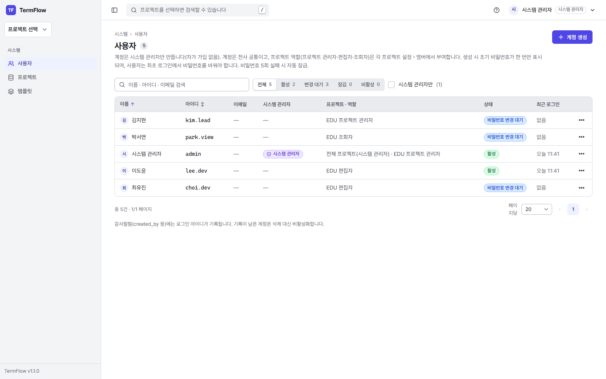

### 3.2 프로젝트 만들기 (`/projects/new`)
한 페이지 3단계.
1. **기본 정보**: 이름, 키(영대문자로 시작하는 영대문자·숫자 2~10자, 예 `HRM` — 주소·파일 이름에 쓰이고 **나중에 바꿀 수 없다**), 설명, 기본 DDL 방언(PostgreSQL).
2. **표준 가져오기**: 업무구분·용어·도메인분류·도메인·코드·기본컬럼 세트마다 원본을 고른다 — [템플릿](기본 "TermFlow 기본 표준 v1") / [다른 프로젝트] / [비움]. 가져올 업무구분 체크, "승인된 용어만"(기본 켬). 오른쪽에 가져올 건수 미리보기. 원본을 섞으면 경고가 뜨고, 만든 뒤 도메인을 다시 검증해 맞지 않는 행을 검토필요로 표시한다.
3. **멤버**: 사용자 검색 → 역할(프로젝트 관리자·편집자·조회자). 만든 사람은 자동으로 프로젝트 관리자.
- [만들기] → 결과 요약(항목별 건수, 검토필요 도메인 링크) → 프로젝트 홈. 표준은 **복사본**이라 이후 템플릿이 바뀌어도 이 프로젝트에는 반영되지 않는다.

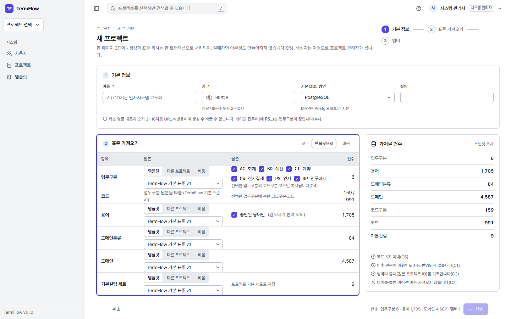

### 3.3 프로젝트 관리 (`/admin/projects`)
- 전체 프로젝트 목록(상태·멤버 수·테이블 수). **보관**하면 모든 쓰기가 막히고 목록에서 숨는다(복원 가능). **삭제**는 보관 상태에서만, 프로젝트 키를 다시 입력해야 한다(되돌릴 수 없음 — 먼저 백업).

### 3.4 템플릿 (`/admin/templates`)
- 템플릿 = 새 프로젝트의 표준 원본(테이블·멤버 없음). [편집]은 일반 표준 사전 화면을 템플릿 모드로 연다(상단에 "템플릿 편집 중 — 이미 만든 프로젝트에는 반영되지 않습니다").
- **[프로젝트에서 게시]**: 잘 정리된 프로젝트의 표준을 새 템플릿으로 만든다(원본 프로젝트·새 키·이름·승인된 용어만). 개정은 기존 템플릿을 고치기보다 "v2"를 새로 게시하는 것을 권장.
- 사용 중인 템플릿(그것으로 만든 프로젝트가 있음)은 삭제할 수 없고 보관만 된다.

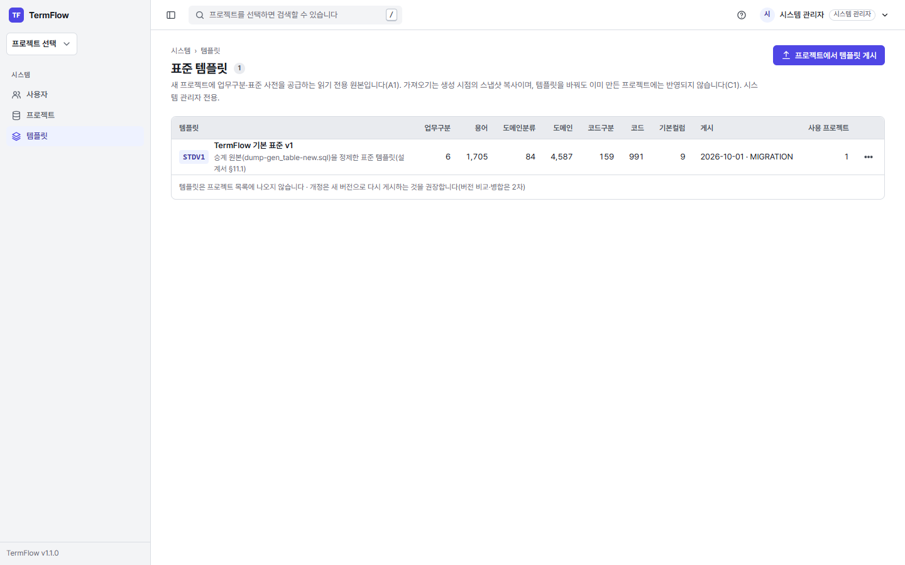

### 3.5 승계 데이터 정정(정정 담당)
검토필요 도메인 정정 절차는 [설치·운영 가이드 §4.4](설치_운영_가이드.md#44-정정정정-담당자-시스템-관리자)(용어 → 도메인분류 일괄 등록 → 도메인 [재계산 › 검토필요 도메인만], STDV1과 RMS 두 곳).

## 4. 프로젝트 관리자

### 4.1 멤버·설정 (`/projects/{키}/settings`)
- **기본 정보**: 이름·설명(키는 읽기 전용).
- **멤버**: 사용자 검색 → 역할 지정·변경·제거. 프로젝트 관리자는 최소 1명 남아야 한다.
- **기본값**: 기본 DDL 방언, 기본컬럼 세트.
- **수명주기**: 보관·복원은 시스템 관리자만(버튼 비활성 + 안내).

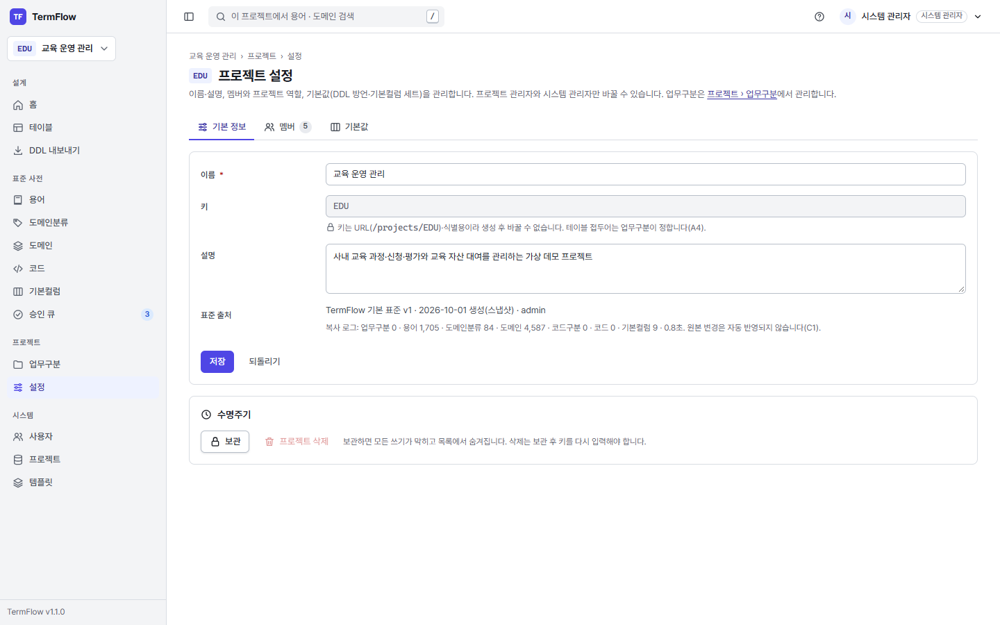

### 4.2 업무구분 (`/projects/{키}/biz-areas`)
- 업무구분 = 테이블 물리명 **접두어**(예 `RP_`)와 코드 분류의 기준. 모든 테이블은 업무구분 하나에 속한다.
- 코드(영대문자·숫자 2~10자)·이름·접두어·정렬·사용 여부를 인라인으로 편집. **테이블이 하나라도 있으면 코드·접두어·사용 여부는 잠긴다**(자물쇠). 삭제는 테이블 0건일 때만(소속 코드구분·코드도 함께 삭제 — 확인 창에 건수 표시).

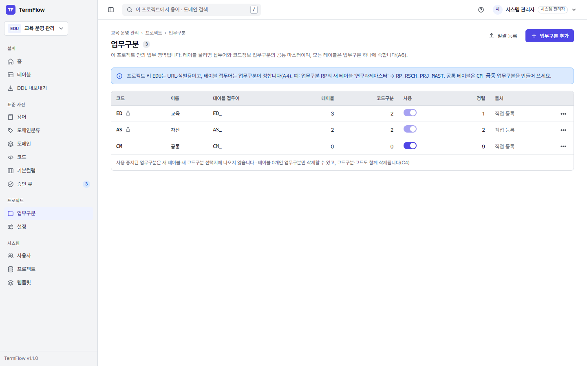

### 4.3 표준 사전 관리
| 화면 | 할 일 |
|---|---|
| **용어** `standards/terms` | 맨 위 입력 줄에 한글 용어·물리약어(영대문자)·설명 → Enter로 바로 등록(승인 상태). 검색·상태 필터, 인라인 수정, 같은 물리약어 충돌 경고, 행 '변경이력' |
| **일괄 등록** `…/import` | [템플릿 다운로드](xlsx) → 작성 → 업로드 → 미리보기(신규 초록·갱신 파랑·오류 빨강·동일 회색) → [적용]. 용어·도메인분류·도메인·코드 공통. 수식 셀은 값으로만 읽는다 |
| **도메인분류** `standards/domain-classes` | 접미어(예 `번호`·`코드`)·명칭·타입·길이·스케일. 사용 도메인 수 표시 |
| **도메인** `standards/domains` | 명칭1~7 조각 입력 → 논리명·물리명·타입 자동 계산 미리보기 → 등록. 수기 타입 토글, **검토필요** 필터, [재계산 ▾](검토필요 도메인만 / 자동 타입 전체) |
| **코드** `standards/codes` | 왼쪽 트리 업무구분 → 코드구분 → 오른쪽 코드 인라인 편집 |
| **기본컬럼** `standards/default-columns` | 세트 선택, 컬럼(순서·PK·타입·기본값) 편집, 기본 세트 지정. 새 테이블 아래쪽 '기본컬럼' 영역에 들어간다 |
| **승인 큐** `standards/approvals` | 편집자가 인라인 등록한 **검토대기** 용어: [승인]·물리약어 고쳐서 승인·[반려](사유 필수)·[선택 승인]. 메뉴 배지 = 대기 건수 |

- 표준을 고쳐도 **이미 저장된 테이블은 자동으로 바뀌지 않는다**. 편집기에서 경고(예: 용어 변경, 도메인 타입 변경)와 [재적용]으로 반영한다.
- 확정(FINAL) 테이블을 고치려면 편집기에서 [확정 해제](프로젝트 관리자) → 수정 → 다시 확정.

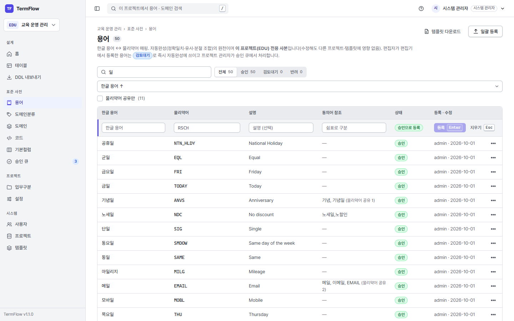

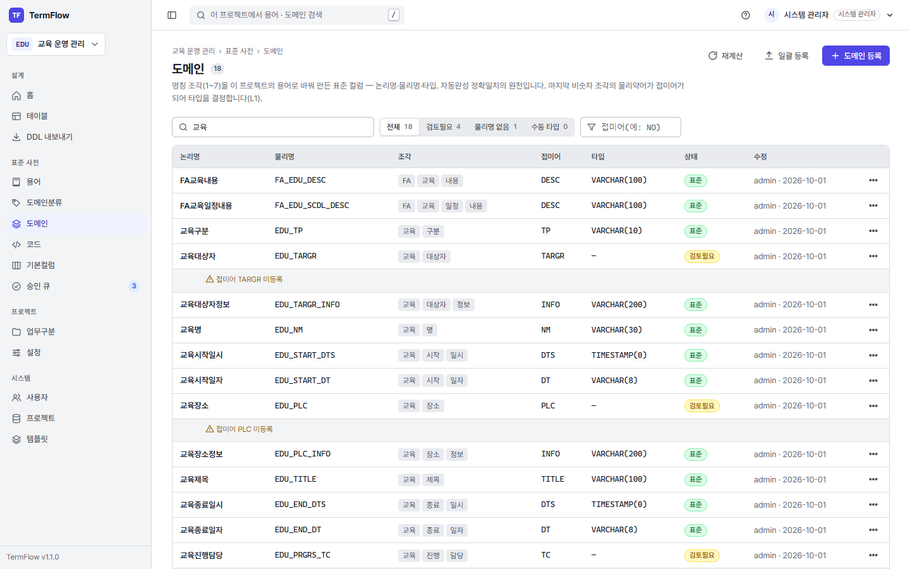

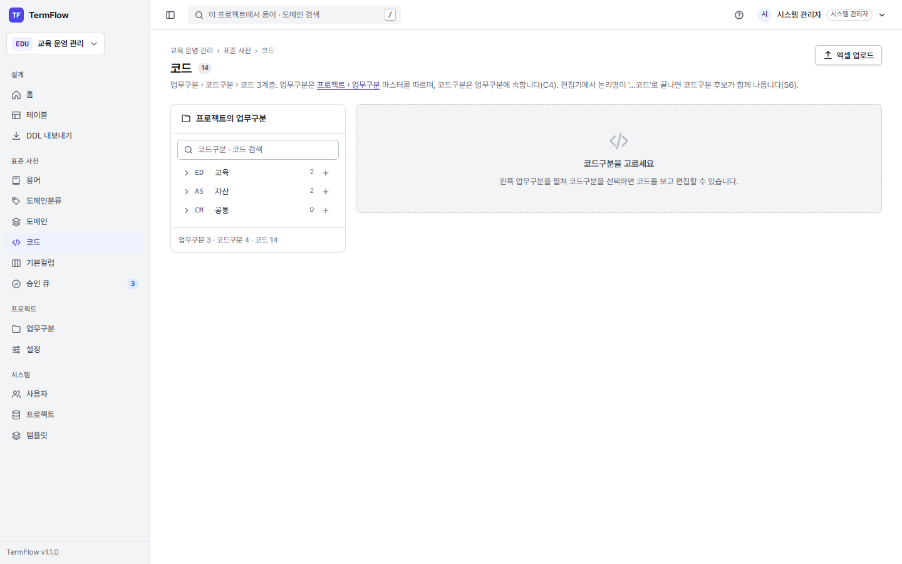

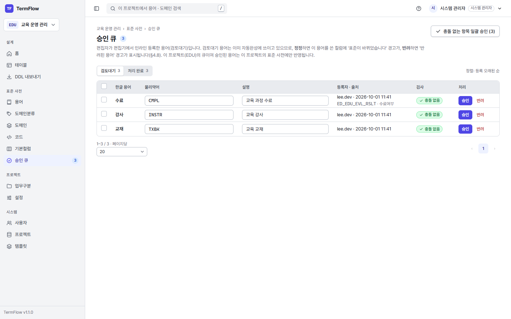

## 5. 편집자 — 테이블 설계

### 5.1 테이블 목록 (`/projects/{키}/tables`)
- 왼쪽 업무구분(건수) → 오른쪽 표(검색·상태 필터). 행 물리명을 누르면 편집기, 행 메뉴에 열기·복제·삭제.
- [새 테이블]은 왼쪽에서 고른 업무구분으로 시작한다.

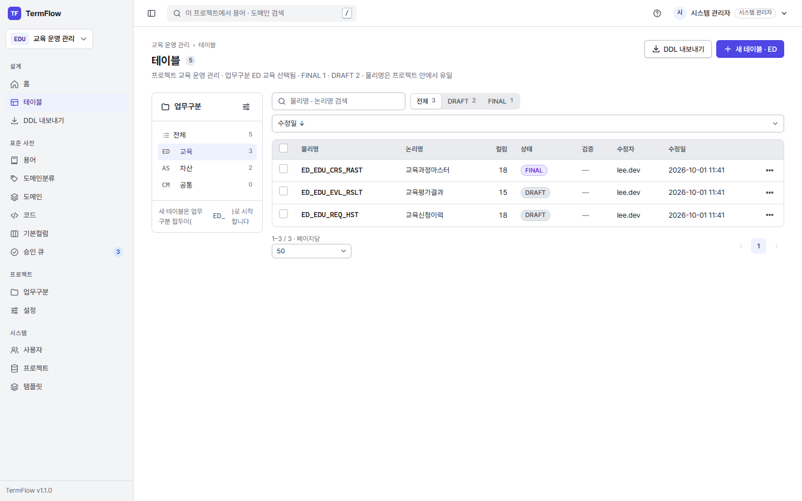

### 5.2 새 테이블 만들기(대표 흐름)
1. [새 테이블] → 머리 부분에 업무구분 확인, **논리명**(예 `교육신청이력`) 입력 → 물리명이 접두어 + 용어 분절로 자동 제안된다(예 `ED_EDU_REQ_HST`). 설명 입력.
2. 그리드 첫 행 **논리명**에 컬럼 이름(예 `교육과정번호`)을 쓰고 **Enter** → 표준 도메인·용어로 물리명·타입·코멘트가 채워지고 다음 행으로 간다. 배지 색:
   - 초록 **표준**: 표준 도메인과 정확히 일치.
   - 노랑 **표준 도메인 아님**: 용어 조각을 조합한 결과(조각 배지 `교육│과정│번호`).
   - 목록이 뜨면(비슷한 도메인 최대 5개 + 조합) ↑↓로 고르고 Enter, Esc는 닫기.
   - 파랑 **코드**: `…코드`로 끝나는 이름은 코드구분 후보가 뜬다 → 선택하면 코드구분 연결(DDL에 코드값 표시 옵션).
   - 빨강 **미등록**: 사전에 없는 조각은 행 아래 **인라인 등록 카드**가 열린다 → 물리약어·설명 입력 → [등록 후 적용](Enter) → 자동으로 다시 계산. 등록한 용어는 **검토대기**(보라)로 바로 쓸 수 있고, 프로젝트 관리자가 승인 큐에서 처리한다.

   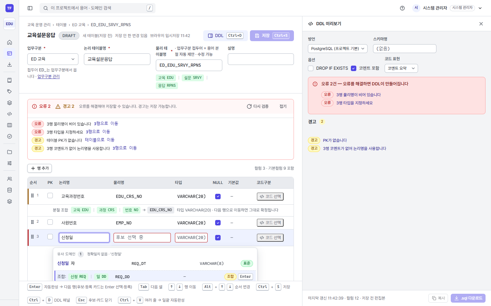

   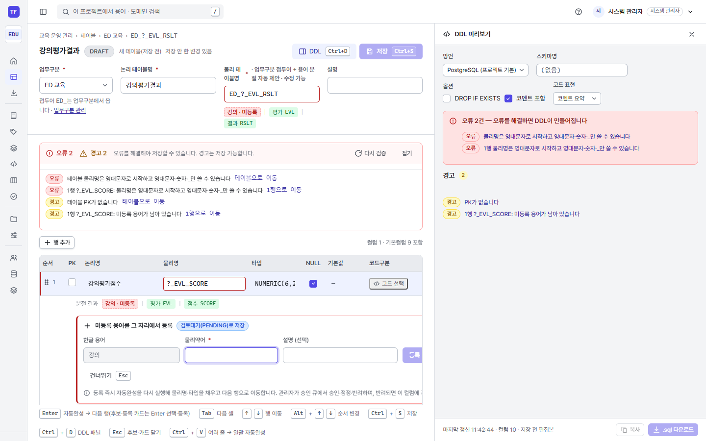
3. 여러 이름을 한 번에: 엑셀 등에서 논리명 여러 줄을 복사해 논리명 칸에 **Ctrl+V** → 행이 추가되고 한 번에 자동완성.
4. PK·NULL 허용·기본값·코멘트를 확인한다. 물리명·타입을 직접 고치면 회색 '수동'이 된다. 아래쪽 **기본컬럼** 영역(최초·최종 등록자·일시 등)은 개별로 뺄 수 있다.
5. **저장 Ctrl+S** → "v1 저장됨". 오류(빨간 테두리)가 있으면 저장 버튼이 비활성이고 첫 오류 칸으로 이동한다.
6. **DDL Ctrl+D** → 오른쪽 DDL 패널(§6.1). 창 폭이 1,500px보다 좁으면 처음에는 닫혀 있다(한 번 열거나 닫으면 그 선택을 기억한다).
7. 설계가 끝나면 상태를 **확정(FINAL)** 으로 바꾼다(이후 읽기 전용, 해제는 프로젝트 관리자).

| 키 | 동작 |
|---|---|
| Enter | (논리명) 자동완성 → 다음 행 / (목록) 선택 / (인라인 카드) 등록 후 적용 |
| Tab · Shift+Tab | 칸 이동 |
| ↑ ↓ | 후보 이동(목록이 없으면 행 이동) |
| Alt+↑ · Alt+↓ | 행 순서 이동 |
| Esc | 목록·카드·팝오버 닫기 |
| Ctrl+S / Ctrl+D | 저장 / DDL 패널 |

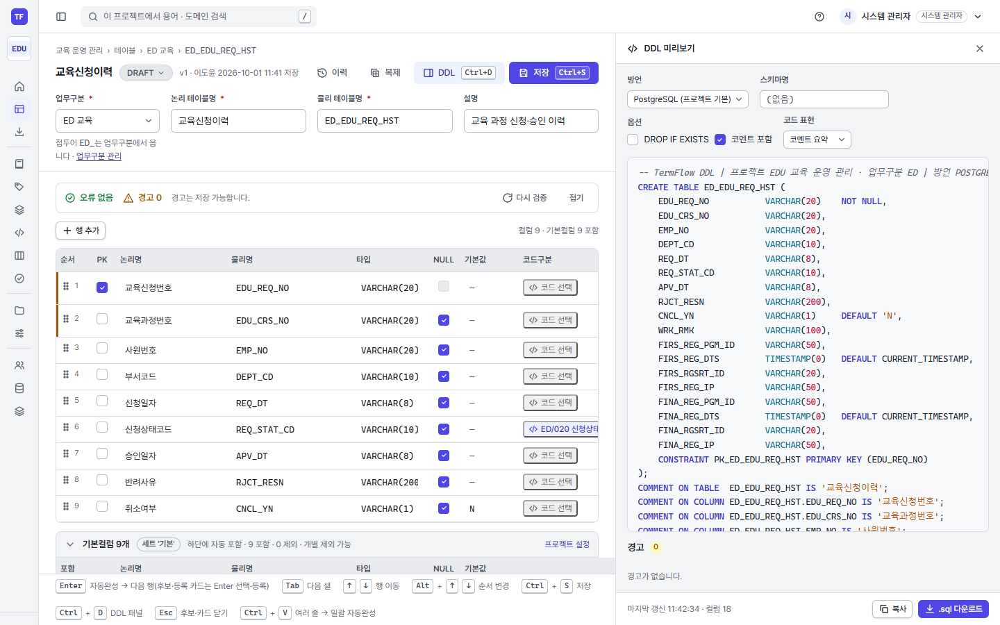

### 5.3 이력·복제·동시 편집
- **[이력]**: 저장할 때마다 버전과 스냅샷이 남는다. 이전 버전 보기·복원(복원도 새 버전으로 저장, 확정 테이블은 확정 해제 후).
- **[복제]**: 같은 프로젝트(새 이름) 또는 다른 프로젝트로 복사(대상 프로젝트의 도메인·코드구분·기본컬럼에 다시 연결).
- **동시 편집**: 다른 사람이 먼저 저장했으면 저장 때 **충돌 병합** 창이 뜬다 — 컬럼별로 내 값/상대 값을 골라 병합 후 저장.
- 편집 중 브라우저가 닫혀도 임시 저장본이 남아 다시 열 때 복원을 제안한다.

## 6. DDL (편집자·조회자)

### 6.1 테이블 한 개 — 편집기 DDL 패널
- 방언(PostgreSQL), 옵션(스키마명 접두·DROP IF EXISTS·코멘트 포함·코드성 컬럼 표현 등), 구문 강조 미리보기, 경고 목록(누르면 해당 행으로).
- [복사] 또는 [.sql 다운로드]. 저장 전 편집 내용도 미리보기에 반영된다. 사내 `http://` 주소로 접속해도 복사된다. 패널의 "DDL 생성 경고"는 DDL을 만들 때 나는 경고로, 편집기 위 검증 바의 경고와 따로 센다.

### 6.2 여러 테이블 — DDL 내보내기 (`/projects/{키}/export`)
1. 업무구분 필터 → 테이블 선택(또는 테이블 목록에서 체크 후 [내보내기]).
2. 방언·옵션(식별자 대·소문자·인용, 줄바꿈 LF/CRLF, 상단 생성 정보 주석, CHECK 제약 등) → 미리보기·경고 확인.
3. 형식: **단일 .sql** / **테이블별 .zip**(업무구분 폴더) / **.tsv 다운로드**(정보 추출: 테이블·컬럼 정의 표). 내보내기 기록은 '최근 내보내기'에 남는다.

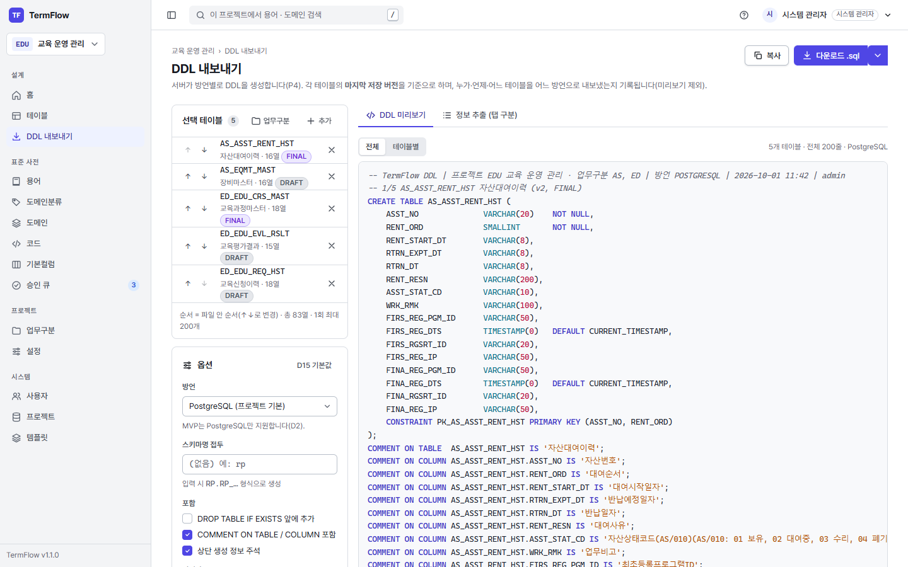

생성된 DDL은 TermFlow가 업무 DB에서 실행하지 않는다 — 담당 DBA가 대상 DB에 적용한다. v1.1.0은 PostgreSQL DDL만 만든다.

## 7. 조회자
- 프로젝트 홈·테이블 목록·편집기(읽기 전용)·표준 사전 화면을 볼 수 있다.
- DDL 미리보기·복사·다운로드·정보 추출(§6)은 할 수 있다.
- 수정이 필요하면 프로젝트 관리자에게 편집자 역할을 요청한다.

## 8. 자주 묻는 질문
| 질문 | 답 |
|---|---|
| 자동완성에 원하는 용어가 없다 | 편집자는 인라인 카드로 등록(검토대기)해 바로 쓴다. 프로젝트 관리자는 [용어]에서 직접 등록 |
| 같은 이름인데 다른 물리명이 나온다 | 그 프로젝트의 표준 사전 기준이다. 프로젝트마다 표준이 독립 사본이다 |
| 확정 테이블을 고칠 수 없다 | 프로젝트 관리자에게 [확정 해제]를 요청한다 |
| 다른 프로젝트가 안 보인다 | 멤버가 아니다. 그 프로젝트 관리자에게 추가를 요청한다 |
| 엑셀 업로드 오류 | 미리보기 빨간 행의 사유를 확인. xlsx만, 기본 10MB 이하 |

## 9. 외부 연동 — 에이전트 도구로 쓰기(v1.3.0, CR-18)

Claude Code 같은 에이전트(MCP 클라이언트)가 **내 권한으로** TermFlow를 쓰게 할 수 있다. 에이전트는 화면과 같은 규칙(자동완성·검증·승인 흐름)으로 표준 용어·도메인을 찾고 등록하며 테이블을 설계·저장하고 DDL을 만든다. 서버 설정 `TERMFLOW_MCP_ENABLED`가 켜져 있어야 한다(기본 꺼짐 — 시스템 관리자에게 요청).

### 9.1 접근 토큰 발급
1. 오른쪽 위 계정 메뉴 → **내 계정** → **외부 연동 접근 토큰**.
2. 이름(예 `내 PC 에이전트`)·유효 기간(30일~1년) → [발급].
3. 토큰(`tfp_…`)과 **연결 설정**이 한 번만 보인다 — 바로 복사한다. 잃어버리면 폐기하고 새로 발급한다.

- 토큰은 발급한 사람의 역할을 그대로 갖는다(조회자 토큰으로는 저장 불가). 토큰으로 한 변경도 내 아이디로 기록된다.
- 토큰으로는 로그인·비밀번호 변경·토큰 발급/폐기·비밀번호 초기화를 할 수 없다(웹에서만).
- 쓰지 않는 토큰은 [폐기]. 관리자가 계정을 비활성화하거나 비밀번호를 초기화하면 토큰도 모두 폐기된다.

### 9.2 Claude Code에 연결
터미널에서(주소·토큰은 자기 것으로):

```bash
claude mcp add --transport http termflow http://<서버>:7340/mcp --header "Authorization: Bearer tfp_…"
```

또는 작업 폴더의 `.mcp.json`에 화면의 **연결 설정**을 붙여 넣는다(팀이 같이 쓰는 저장소라면 토큰을 커밋하지 않도록 `.mcp.json`을 개인 설정으로 두거나 `--scope user`로 등록한다). `/mcp`에서 `termflow`가 connected인지 확인한다.

### 9.3 쓰는 법
- 그냥 요청하면 된다: "RMS 프로젝트 연구과제(RP) 업무구분에 과제 협약 이력 테이블 설계해 줘. 협약번호, 협약일자, 협약금액, 협약상태코드…".
- 준비된 흐름: `/mcp__termflow__design_table` (프로젝트 키·요구사항 입력) — 컬럼 논리명 정리 → 자동완성 → 미등록 용어·도메인 등록안 확인 → 검증 → 저장 → DDL 순으로 진행한다.
- 도구는 REST API와 1:1(예 `columns_autocomplete`, `table_create`, `term_request`, `domain_create`)이다. 미등록 용어를 편집자가 등록하면 **검토대기**로 들어가 프로젝트 관리자가 승인 큐에서 확정한다(화면 인라인 등록과 같다).
- 에이전트를 거친 표준 사전·테이블 정의는 그 에이전트가 쓰는 모델 서비스로 전송될 수 있다. 사내 정보보호 기준에 맞는 프로젝트에서만 쓴다.
